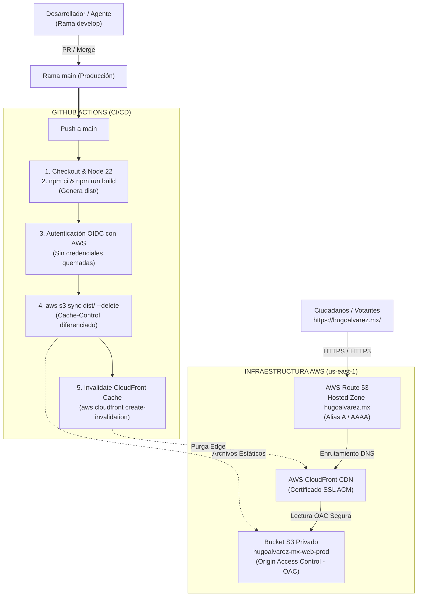

# 🚀 Plan de Despliegue Automatizado para `hugoalvarez.mx`

**Proyecto:** MKT 499 — Sitio Oficial de Campaña y HugoFest Emprendedor  
**Repositorio:** `hugoalvarezmx` (`yagahaus/hugoalvarezmx`)  
**Dominio de Producción:** [https://hugoalvarez.mx/](https://hugoalvarez.mx/)  
**Infraestructura:** AWS S3 + CloudFront + Route 53 (perfil `--profile dmv0`)  

---

## 🎯 1. Resumen Ejecutivo y Arquitectura

Para garantizar **velocidad extrema de carga**, **tolerancia a picos masivos de tráfico** y **cero costos de mantenimiento de servidores**, la infraestructura recomendada para el despliegue del framework **Astro** es una arquitectura **100% Serverless en el Edge de AWS**:



---

## 🏛️ 2. Componentes de Infraestructura en AWS (Valores Provisionados)

| Componente | Recurso / Configuración | Detalle / ID | Propósito |
| :--- | :--- | :--- | :--- |
| **DNS** | **AWS Route 53** | Hosted Zone `Z04813761RU9V5EPD9HNX` | Resuelve `hugoalvarez.mx` y `www.hugoalvarez.mx` mediante registros Alias tipo `A` y `AAAA` hacia CloudFront. |
| **Almacenamiento** | **AWS S3** | `hugoalvarez-mx-web-prod` (`us-east-1`) | Bucket privado que almacena los archivos estáticos compilados de Astro (`dist/`). |
| **Seguridad de Origen** | **Origin Access Control (OAC)** | ID: `E3H67VP7DKVVV3` (`oac-hugoalvarez-mx-s3`) | Bloquea el acceso público directo a S3; **únicamente CloudFront** tiene permisos de lectura (`s3:GetObject`). |
| **CDN & SSL** | **AWS CloudFront** | Distribution ID: `EGJPF1AJ6TNCJ`<br/>Dominio: `dtp7r8ccotg6m.cloudfront.net` | Distribución global con compresión Brotli/Gzip, HTTP/2, HTTP/3 y certificado SSL TLS 1.3 emitido en `us-east-1`. |
| **Certificado SSL** | **AWS ACM** | ARN: `arn:aws:acm:us-east-1:554439199619:certificate/3f5029b6-1722-4735-a0a8-491cd3a664f8` | Certificado validado por DNS para `hugoalvarez.mx` y `www.hugoalvarez.mx`. |
| **URL Rewriter** | **CloudFront Function** | `cf-subfolder-index-rewrite` | Reescritura transparente de subdirectorios para Astro SSG (`/seccion/` ➔ `/seccion/index.html`). |
| **CI/CD** | **GitHub Actions** + **AWS IAM OIDC** | Workflow `.github/workflows/deploy.yml` | Pipeline automatizado que compila y sincroniza el sitio en cada merge a `main`. |

---

## ⚡ 3. Pipeline de Despliegue Automatizado (GitHub Actions)

El flujo de trabajo queda configurado en `.github/workflows/deploy.yml`:

### 3.1. Disparadores (Triggers)
* `push` a la rama `main` (despliegue automático de producción).
* `workflow_dispatch` (botón de ejecución manual en GitHub para re-despliegues bajo demanda).

### 3.2. Estrategia de Caché de S3 y CloudFront
Para lograr una navegación instantánea sin riesgo de que los usuarios vean contenido obsoleto:
1. **Activos inmutables (`_astro/*`, imágenes, fuentes, CSS/JS con hash):**  
   `Cache-Control: public, max-age=31536000, immutable` (permanecen 1 año en la caché del navegador).
2. **Archivos HTML (`*.html`, `index.html`, etc.):**  
   `Cache-Control: public, max-age=0, must-revalidate` (el navegador siempre valida la última versión en el Edge).
3. **Invalidación global:**  
   Al terminar la sincronización, se invoca `aws cloudfront create-invalidation --distribution-id $DISTRIBUTION_ID --paths "/*"`.

---

## 🛠️ 4. Alternativa Local Supervisada (`scripts/deploy_aws.sh`)

Para permitir que cualquier agente o desarrollador despliegue a producción desde su terminal local en macOS (utilizando `--profile dmv0` sin pasar por GitHub Actions), se incluye el script ejecutable:

```bash
# Compilar y desplegar a AWS con un solo comando:
./scripts/deploy_aws.sh

# Soporte para banderas:
./scripts/deploy_aws.sh --dry-run      # Ver archivos sin transferir
./scripts/deploy_aws.sh --skip-build   # Desplegar el dist/ existente
```

---

## 📋 5. Estado de Aprovisionamiento en AWS

Los recursos de infraestructura han sido aprovisionados y enlazados exitosamente:

- ✅ **Bucket S3 Privado:** `hugoalvarez-mx-web-prod` (región `us-east-1`, bloqueo público activo).
- ✅ **Certificado SSL ACM:** `arn:aws:acm:us-east-1:554439199619:certificate/3f5029b6-1722-4735-a0a8-491cd3a664f8` (`ISSUED`).
- ✅ **Origin Access Control (OAC):** `E3H67VP7DKVVV3` asignado en CloudFront y autorizado en la Bucket Policy de S3.
- ✅ **CloudFront Function:** `cf-subfolder-index-rewrite` publicada y asociada al evento `viewer-request`.
- ✅ **Distribución CloudFront:** `EGJPF1AJ6TNCJ` (`dtp7r8ccotg6m.cloudfront.net`).
- ✅ **Registros DNS en Route 53:** Registros Alias `A` y `AAAA` para `hugoalvarez.mx` y `www.hugoalvarez.mx` apuntando a `dtp7r8ccotg6m.cloudfront.net`.
