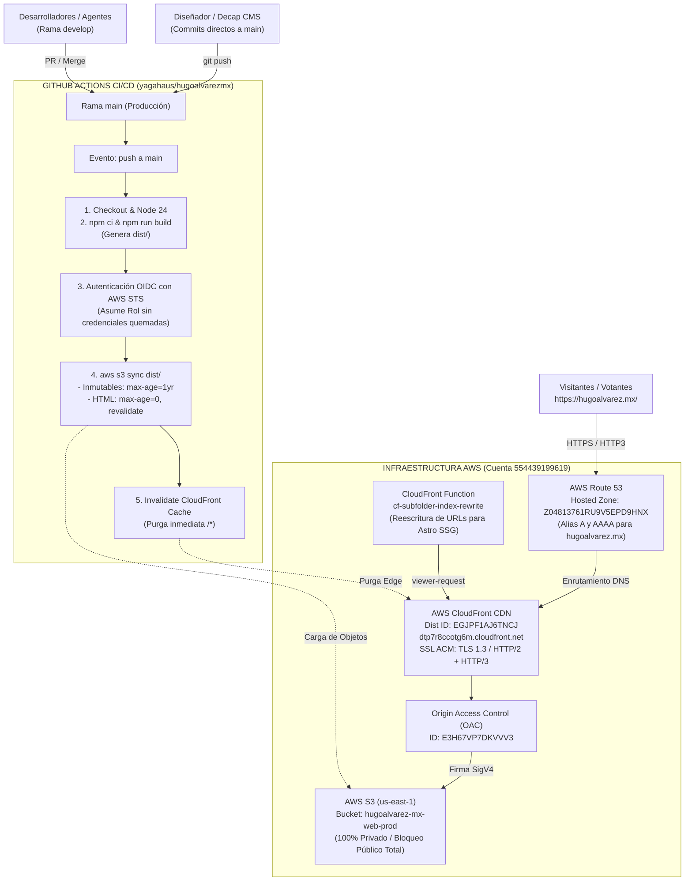

# 🚀 Arquitectura y Plan de Despliegue Automatizado para `hugoalvarez.mx`

**Proyecto:** MKT 499 — Sitio Oficial de Campaña y HugoFest Emprendedor  
**Repositorio GitHub:** `yagahaus/hugoalvarezmx` ([https://github.com/yagahaus/hugoalvarezmx](https://github.com/yagahaus/hugoalvarezmx))  
**Dominio de Producción:** [https://hugoalvarez.mx/](https://hugoalvarez.mx/) (y [https://www.hugoalvarez.mx/](https://www.hugoalvarez.mx/))  
**Infraestructura Cloud:** AWS S3 + CloudFront + Route 53 + IAM OIDC (Cuenta: `554439199619`, perfil CLI: `--profile dmv0`)  

---

## 🎯 1. Resumen Ejecutivo y Diagrama de Arquitectura

La entrega del framework **Astro** opera sobre una arquitectura **100% Serverless en el Edge de AWS**: cero servidores que administrar, tolerancia a picos masivos de tráfico, entrega global ultra rápida vía CloudFront (Brotli/Gzip + HTTP/3) y autenticación segura sin contraseñas ni claves de larga duración mediante **OpenID Connect (OIDC)**:



---

## 🏛️ 2. Ficha Técnica de Infraestructura en AWS

| Parámetro | Valor Configurado | Descripción / Propósito |
| :--- | :--- | :--- |
| **Cuenta AWS ID** | `554439199619` | Cuenta oficial de infraestructura de DiMedia. |
| **Perfil AWS CLI** | `--profile dmv0` | Perfil obligatorio para todas las operaciones de terminal. |
| **Usuario IAM CLI** | `masterdm-cli-dmv8` | Usuario administrativo de aprovisionamiento. |
| **Hosted Zone Route 53** | `Z04813761RU9V5EPD9HNX` | Zona pública autoritativa para `hugoalvarez.mx.`. |
| **Bucket S3** | `hugoalvarez-mx-web-prod` | Bucket privado en `us-east-1` para estáticos de Astro. |
| **Origin Access Control** | `E3H67VP7DKVVV3` | Identidad de control de acceso para proteger el bucket S3. |
| **CloudFront Distribution** | `EGJPF1AJ6TNCJ` | Distribución CDN global (`dtp7r8ccotg6m.cloudfront.net`). |
| **Edge Function** | `cf-subfolder-index-rewrite` | Función CloudFront JS 2.0 para reescritura de rutas Astro. |
| **Certificado SSL ACM** | `3f5029b6-1722-4735-a0a8-491cd3a664f8` | Certificado multi-SAN (`hugoalvarez.mx`, `www.hugoalvarez.mx`). |
| **Proveedor IAM OIDC** | `token.actions.githubusercontent.com` | Identidad federada para GitHub Actions. |
| **Rol IAM de Despliegue** | `github-actions-hugoalvarezmx-deploy` | Rol asumido temporalmente por GitHub Actions durante el CI/CD. |

---

## 🔐 3. Identidad de Seguridad y Configuración IAM OIDC

El despliegue no almacena Access Keys ni Secret Keys permanentes en GitHub. Utiliza el estándar **OpenID Connect (OIDC)** de AWS STS (`sts:AssumeRoleWithWebIdentity`):

### 3.1. Proveedor de Identidad OIDC en AWS
* **ARN:** `arn:aws:iam::554439199619:oidc-provider/token.actions.githubusercontent.com`
* **URL:** `https://token.actions.githubusercontent.com`
* **Audiencia (`aud`):** `sts.amazonaws.com`
* **Thumbprints Registrados:**
  1. `06d927fecd0a84aeba28aad1d808139470fe95c3` *(Certificado actual Let's Encrypt / ISRG Root)*
  2. `2d74d6dfd96eea55ad7baafa0d3c6552b2dadc37`
  3. `1c58a3a8518e8759bf075b76b750d4f8d73b0a65`
  4. `6938fd4d98bab03faadb97b34396831e3780aea1`

### 3.2. Rol IAM de Despliegue
* **Nombre:** `github-actions-hugoalvarezmx-deploy`
* **ARN:** `arn:aws:iam::554439199619:role/github-actions-hugoalvarezmx-deploy`
* **Role ID:** `AROAYCFZGZOBYRVL2QPNX`

#### Política de Confianza (Trust Relationship):
Configurada para coincidir con el claim estricto de GitHub Actions en organizaciones (incluyendo IDs numéricos de repositorio y organización):
```json
{
  "Version": "2012-10-17",
  "Statement": [
    {
      "Effect": "Allow",
      "Principal": {
        "Federated": "arn:aws:iam::554439199619:oidc-provider/token.actions.githubusercontent.com"
      },
      "Action": [
        "sts:AssumeRoleWithWebIdentity",
        "sts:TagSession"
      ],
      "Condition": {
        "StringEquals": {
          "token.actions.githubusercontent.com:aud": "sts.amazonaws.com",
          "token.actions.githubusercontent.com:repository": "yagahaus/hugoalvarezmx"
        },
        "StringLike": {
          "token.actions.githubusercontent.com:sub": [
            "repo:yagahaus/hugoalvarezmx:*",
            "repo:yagahaus@349728407/hugoalvarezmx@1437871979:*",
            "repo:yagahaus*/*hugoalvarezmx*:*"
          ]
        }
      }
    }
  ]
}
```

#### Política de Permisos (`S3CloudFrontDeployPolicy`):
Permisos de mínimo privilegio para cargar objetos a S3 e invalidar CloudFront:
```json
{
  "Version": "2012-10-17",
  "Statement": [
    {
      "Sid": "AllowS3SyncWebProd",
      "Effect": "Allow",
      "Action": [
        "s3:PutObject",
        "s3:GetObject",
        "s3:ListBucket",
        "s3:DeleteObject",
        "s3:GetBucketLocation"
      ],
      "Resource": [
        "arn:aws:s3:::hugoalvarez-mx-web-prod",
        "arn:aws:s3:::hugoalvarez-mx-web-prod/*"
      ]
    },
    {
      "Sid": "AllowCloudFrontInvalidation",
      "Effect": "Allow",
      "Action": [
        "cloudfront:CreateInvalidation",
        "cloudfront:GetInvalidation"
      ],
      "Resource": "arn:aws:cloudfront::554439199619:distribution/EGJPF1AJ6TNCJ"
    }
  ]
}
```

---

## 🗄️ 4. Almacenamiento en S3 y Política de Bucket

* **Bucket:** `hugoalvarez-mx-web-prod` (Región `us-east-1`).
* **Bloqueo Público:** 100% activo (`BlockPublicAcls`, `IgnorePublicAcls`, `BlockPublicPolicy`, `RestrictPublicBuckets`).
* **Origin Access Control (OAC):** `E3H67VP7DKVVV3` (`oac-hugoalvarez-mx-s3`).

### Política de Acceso de S3 (Bucket Policy):
Únicamente CloudFront puede leer los archivos; cualquier intento de acceso directo a S3 desde Internet es rechazado con 403:
```json
{
  "Version": "2012-10-17",
  "Statement": [
    {
      "Sid": "AllowCloudFrontServicePrincipalReadOnly",
      "Effect": "Allow",
      "Principal": {
        "Service": "cloudfront.amazonaws.com"
      },
      "Action": "s3:GetObject",
      "Resource": "arn:aws:s3:::hugoalvarez-mx-web-prod/*",
      "Condition": {
        "StringEquals": {
          "AWS:SourceArn": "arn:aws:cloudfront::554439199619:distribution/EGJPF1AJ6TNCJ"
        }
      }
    }
  ]
}
```

---

## ⚡ 5. CDN CloudFront y Función Edge para Astro SSG

* **Distribución ID:** `EGJPF1AJ6TNCJ`
* **Dominio por Defecto:** `dtp7r8ccotg6m.cloudfront.net`
* **Dominios Alternativos (CNAMEs):** `hugoalvarez.mx`, `www.hugoalvarez.mx`
* **Políticas de Caché y Seguridad:**
  * Caché optimizada: `Managed-CachingOptimized` (`658327ea-f89d-4fab-a63d-7e88639e58f6`).
  * Cabeceras de seguridad: `Managed-SecurityHeadersPolicy` (`67f7725c-6f97-4210-82d7-5512b31e9d03`).
  * Respuestas de error personalizadas: Códigos 403 y 404 retornan `/404.html` con estatus HTTP 404.

### Edge Function: `cf-subfolder-index-rewrite`
Para que rutas como `/hugofest` o `/blog/articulo/` carguen sin requerir que el usuario escriba `/index.html`, la función asociada al evento `viewer-request` reescribe la URI transparentemente:
```javascript
function handler(event) {
    var request = event.request;
    var uri = request.uri;
    
    if (uri.endsWith('/')) {
        request.uri += 'index.html';
    } else if (!uri.includes('.')) {
        request.uri += '/index.html';
    }

    return request;
}
```

---

## ⚙️ 6. Pipeline de CI/CD en GitHub Actions

El archivo de automatización vive en `.github/workflows/deploy.yml`:

```yaml
name: Deploy to AWS S3 & CloudFront

on:
  push:
    branches:
      - main
  workflow_dispatch:

permissions:
  id-token: write
  contents: read

jobs:
  build-and-deploy:
    runs-on: ubuntu-latest
    steps:
      - name: Checkout Code
        uses: actions/checkout@v4

      - name: Setup Node.js
        uses: actions/setup-node@v4
        with:
          node-version: 22
          cache: 'npm'

      - name: Install Dependencies
        run: npm ci

      - name: Build Astro Site
        run: npm run build

      - name: Configure AWS Credentials (OIDC)
        uses: aws-actions/configure-aws-credentials@v4
        with:
          role-to-assume: ${{ secrets.AWS_ROLE_ARN }}
          aws-region: us-east-1
          audience: sts.amazonaws.com
          role-skip-session-tagging: true

      - name: Sync Static Assets to S3 (Immutable Cache)
        run: |
          aws s3 sync dist/ s3://${{ secrets.AWS_S3_BUCKET || 'hugoalvarez-mx-web-prod' }}/ \
            --delete \
            --exclude "*.html" \
            --cache-control "public, max-age=31536000, immutable"

      - name: Sync HTML Files to S3 (No-Cache / Must-Revalidate)
        run: |
          aws s3 sync dist/ s3://${{ secrets.AWS_S3_BUCKET || 'hugoalvarez-mx-web-prod' }}/ \
            --exclude "*" \
            --include "*.html" \
            --cache-control "public, max-age=0, must-revalidate"

      - name: Invalidate CloudFront Cache
        run: |
          aws cloudfront create-invalidation \
            --distribution-id ${{ secrets.AWS_CLOUDFRONT_DIST_ID || 'EGJPF1AJ6TNCJ' }} \
            --paths "/*"
```

### Secretos Registrados en GitHub (`yagahaus/hugoalvarezmx`):
* `AWS_ROLE_ARN`: `arn:aws:iam::554439199619:role/github-actions-hugoalvarezmx-deploy`
* `AWS_S3_BUCKET`: `hugoalvarez-mx-web-prod`
* `AWS_CLOUDFRONT_DIST_ID`: `EGJPF1AJ6TNCJ`

---

## 🌿 7. Estrategia de Ramas y Blindaje Operativo

Para proteger el flujo de trabajo del diseñador y mantener el orden del centro de mando:

| Elemento | Rama `main` (Producción & Diseñador) | Rama `develop` (Agencia & Agentes) |
| :--- | :--- | :--- |
| **Propósito** | Producción en vivo y espacio de trabajo de diseño / Decap CMS. | Desarrollo, experimentos, planeación y agentes de IA DiMedia. |
| **Archivos de CI/CD** | `.github/workflows/deploy.yml`, `scripts/deploy_aws.sh`. | `.github/workflows/deploy.yml`, `scripts/deploy_aws.sh`. |
| **Archivos de Agente** | **PROHIBIDOS** (`AGENTS.md`, `bitacora.md`, `.agents/skills`). | **INCLUIDOS** (`AGENTS.md`, `bitacora.md`, `.agents/skills`, `docs/`). |
| **Comportamiento CI/CD** | Cada commit o merge a `main` despliega en automático a `hugoalvarez.mx`. | No dispara despliegue (permite trabajar sin alterar producción). |
